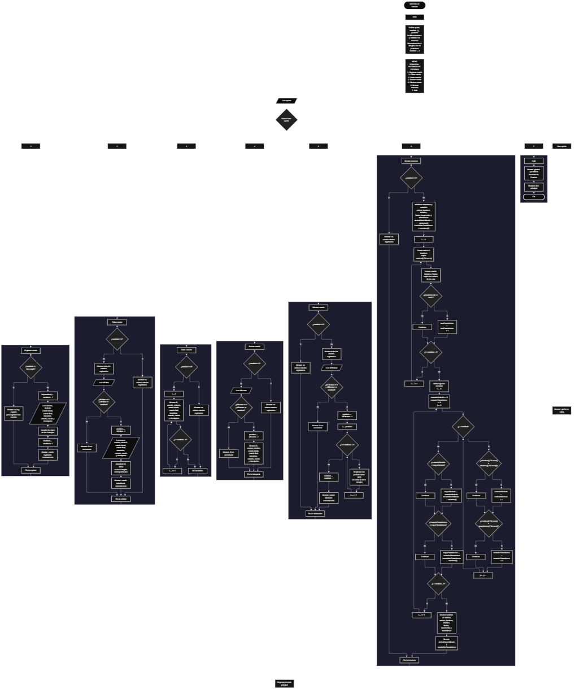

Este proyecto, llamado <b>automata de estados</b>, fue desarrollado en <b>visual basic .net</b> como un ejercicio práctico para fortalecer la lógica de programación mediante la creación de un sistema de gestión de estados de un autómata desde la consola. El programa cuenta con un menú principal de siete opciones que permite <b>registrar, editar, eliminar, buscar, listar y consultar un resumen</b> de los estados almacenados. Cada registro contiene información como el nombre, símbolo, estado inicial, estado final, transición, entrada, situación y descripción, utilizando arreglos paralelos con una capacidad máxima de <b>10 estados durante la ejecución</b>. Durante su desarrollo se aplicaron conceptos fundamentales de programación, como variables, arreglos, estructuras condicionales, ciclos repetitivos y estructuras de selección, además de procesos para buscar, modificar, eliminar y reorganizar registros. También incorpora un resumen estadístico que permite conocer la cantidad de estados activos, inactivos, iniciales, finales e intermedios, así como identificar el símbolo más utilizado y el estado con más referencias de transición. Este proyecto permite poner en práctica los conocimientos adquiridos en Visual Basic .NET y sirve como base para desarrollar sistemas de gestión más avanzados.

<h2 align="center">⚙️ Funcionamiento del menú principal</h2>

### ➕ Registrar estado

La opción <b>1) registrar estado</b> permite almacenar un nuevo estado del autómata. Antes de realizar el registro, el sistema comprueba que la cantidad de estados almacenados sea menor que la capacidad máxima de los arreglos, utilizando la condición <b>cantidad &gt;= ids.Length</b>. Si existe espacio disponible, asigna un identificador mediante la expresión <b>cantidad + 1</b> y solicita el <b>nombre, símbolo, estado inicial, estado final, transición, entrada, situación y descripción</b> del estado. Los datos se almacenan en la posición correspondiente de sus respectivos arreglos. Finalmente, incrementa la variable <b>cantidad</b> en uno y muestra el mensaje <b>"estado registrado correctamente."</b>. Si los diez espacios están ocupados, presenta el mensaje <b>"no hay espacio para registrar mas estados."</b>, impidiendo agregar otro registro.

### ✏️ Editar estado

La opción <b>2) editar estado</b> permite modificar la información de un estado registrado. Primero, el programa comprueba si existen estados almacenados mediante la variable <b>cantidad</b>. Si no hay registros, muestra el mensaje <b>"no existen estados registrados."</b>. En caso contrario, presenta una lista con los datos de todos los estados para facilitar su identificación. Después, solicita el ID del estado que se desea editar y comprueba que se encuentre dentro del rango permitido mediante la condición <b>idEditar &gt;= 1 And idEditar &lt;= cantidad</b>. Si la selección es válida, obtiene la posición correspondiente mediante la expresión <b>idEditar - 1</b> y solicita el nuevo nombre, símbolo, estado inicial, estado final, transición, entrada, situación y descripción. Los valores se actualizan directamente en sus respectivos arreglos, conservando el identificador original. Finalmente, presenta el mensaje <b>"estado actualizado correctamente."</b>. Si el ID introducido está fuera del rango permitido, muestra el mensaje <b>"ID no encontrada."</b>.

### 🗑️ Eliminar estado

La opción <b>5) eliminar estado</b> permite eliminar un estado registrado mediante su identificador. Antes de comenzar, el programa comprueba que existan estados almacenados. Si no hay registros, muestra el mensaje <b>"no existen estados registrados."</b>. En caso contrario, presenta una lista con la información de los estados disponibles. Después, solicita el ID del estado que se desea eliminar y comprueba que se encuentre dentro del rango válido. Si el identificador es correcto, obtiene su posición mediante la expresión <b>idEliminar - 1</b> y comienza el proceso de eliminación. Para mantener los registros organizados, utiliza un ciclo <b>For</b> controlado por la variable <b>i</b>, que desplaza una posición hacia atrás los datos posteriores en los nueve arreglos: <b>ids, nombres, simbolos, estadosIniciales, estadosFinales, transiciones, entradas, estados y descripciones</b>. Posteriormente, disminuye la variable <b>cantidad</b> en uno y muestra el mensaje <b>"estado eliminado correctamente."</b>. Si el ID introducido no se encuentra dentro del rango permitido, presenta el mensaje <b>"ID no encontrada."</b>.

### 🔎 Buscar estado

La opción <b>4) buscar estado</b> permite localizar un estado mediante su identificador. Primero, el programa comprueba si existen estados registrados. Si no hay registros, muestra el mensaje <b>"no existen estados registrados."</b>. En caso contrario, solicita el ID del estado que se desea buscar y verifica que esté dentro del rango permitido mediante la condición <b>idBuscar &gt;= 1 And idBuscar &lt;= cantidad</b>. Si el identificador es válido, calcula la posición correspondiente utilizando la expresión <b>idBuscar - 1</b> y muestra toda la información almacenada: <b>nombre, símbolo, estado inicial, estado final, transición, entrada, situación y descripción</b>. Si el ID introducido no corresponde al rango de registros disponibles, presenta el mensaje <b>"ID no encontrada."</b>.

### 📋 Listar estados

La opción <b>3) listar estados</b> permite visualizar todos los estados registrados actualmente en el sistema. Antes de mostrar la información, el programa comprueba si la variable <b>cantidad</b> es igual a cero. Si no existen registros, presenta el mensaje <b>"no existen estados registrados."</b>. Si hay estados disponibles, utiliza un ciclo <b>For</b> para recorrer los arreglos desde la primera posición hasta <b>cantidad - 1</b>. Durante el recorrido, muestra el identificador, nombre, símbolo, estado inicial, estado final, transición, entrada, situación y descripción de cada estado. Esta función facilita consultar los registros existentes sin necesidad de buscar cada estado individualmente.

### 📊 Mostrar resumen

La opción <b>6) mostrar resumen</b> permite consultar estadísticas generales de los estados registrados. Primero, el programa comprueba si existen registros almacenados. Si no hay estados, muestra el mensaje <b>"no existen estados registrados."</b>. En caso contrario, inicializa diferentes contadores y variables para calcular la cantidad de estados activos, inactivos, iniciales, finales e intermedios, así como el total de transiciones registradas. También utiliza ciclos <b>For</b> anidados para comparar los símbolos y los nombres de los estados con las transiciones almacenadas. De esta manera, identifica el <b>símbolo más utilizado</b> y el <b>estado con más referencias de transición</b>. Finalmente, muestra todos los resultados en un resumen general. Esta operación permite conocer la distribución y las relaciones registradas entre los estados del autómata.

### 🚪 Salir del menú principal

La opción <b>7) salir</b> está destinada a finalizar la ejecución del programa y muestra el mensaje <b>"gracias por utilizar Automata de Estados."</b>. El menú principal se encuentra dentro de una estructura repetitiva <b>Do...Loop While</b>, que mantiene el programa en funcionamiento mientras la opción seleccionada sea diferente de <b>7</b>. Cuando el usuario selecciona esta opción, la condición <b>opcion &lt;&gt; 7</b> deja de cumplirse y el ciclo termina, finalizando la ejecución del programa.

<h2 align="center">🧠 Temas aplicados en el proyecto</h2>

### 📦 Variables

En este proyecto se utilizan variables para controlar la cantidad de estados registrados, almacenar la opción seleccionada en el menú, identificar los registros que se desean editar, buscar o eliminar, controlar los recorridos de los arreglos y calcular las estadísticas del resumen. También se utilizan variables auxiliares para contar los estados según sus características y determinar cuáles son los símbolos y estados con mayor frecuencia de aparición.

🔢 **Opcion:** Almacena la opción seleccionada por el usuario en el menú principal.

📊 **Cantidad:** Controla el número actual de estados registrados.

🔎 **IdEditar:** Almacena el identificador del estado que se desea modificar.

🔍 **IdBuscar:** Almacena el identificador del estado que se desea consultar.

🗑️ **IdEliminar:** Almacena el identificador del estado que se desea eliminar.

📍 **Posicion:** Permite obtener el índice del arreglo correspondiente al identificador seleccionado.

🔄 **I:** Funciona como contador en los ciclos `For` y permite recorrer los registros, reorganizar los arreglos y realizar comparaciones.

🔁 **J:** Controla el recorrido interno de los ciclos anidados utilizados para comparar símbolos y transiciones.

📈 **Activos:** Cuenta los estados cuya situación es activa.

📉 **Inactivos:** Cuenta los estados cuya situación es inactiva.

🏁 **Iniciales:** Cuenta los estados identificados como iniciales.

🏆 **Finales:** Cuenta los estados identificados como finales.

🔀 **Intermedios:** Cuenta los estados que no son iniciales ni finales.

🔗 **TotalTransiciones:** Cuenta los registros que contienen una transición no vacía.

🔠 **SimboloMasUtilizado:** Almacena el símbolo que aparece con mayor frecuencia.

🔢 **MayorSimbolo:** Guarda la mayor frecuencia encontrada para un símbolo.

🔗 **EstadoMasTransiciones:** Almacena el nombre del estado con más referencias dentro del arreglo de transiciones.

📊 **MayorTransiciones:** Guarda la mayor cantidad de referencias de transición encontrada.

### 🗃️ Arreglos

En este proyecto se utilizan nueve arreglos paralelos para almacenar la información correspondiente a cada estado del autómata. Cada arreglo tiene una capacidad de <b>10 posiciones</b> y utiliza el mismo índice para representar los datos de un mismo registro. Por ejemplo, la información de un estado almacenado en la posición <b>0</b> se encuentra distribuida entre <b>ids(0), nombres(0), simbolos(0), estadosIniciales(0), estadosFinales(0), transiciones(0), entradas(0), estados(0) y descripciones(0)</b>. Esta organización permite recorrer, buscar, modificar, mostrar y eliminar los estados de manera ordenada.

🆔 **Ids(10):** Almacena los identificadores de los estados registrados.

📝 **Nombres(10):** Almacena los nombres asignados a cada estado.

🔠 **Simbolos(10):** Almacena los símbolos correspondientes a los estados.

🏁 **EstadosIniciales(10):** Indica si cada estado está identificado como inicial mediante los valores `Si` o `No`.

🏆 **EstadosFinales(10):** Indica si cada estado está identificado como final mediante los valores `Si` o `No`.

🔗 **Transiciones(10):** Almacena las transiciones relacionadas con cada estado.

📥 **Entradas(10):** Almacena las entradas correspondientes a cada estado.

⚙️ **Estados(10):** Almacena la situación de cada registro, que puede ser activo o inactivo.

📄 **Descripciones(10):** Almacena información descriptiva de cada estado.

### 🔀 Estructuras condicionales

En este proyecto se utilizan las estructuras <b>If...Else</b> para comprobar si existen estados registrados antes de realizar determinadas operaciones, verificar la disponibilidad de espacio durante el registro, validar los identificadores introducidos y controlar las condiciones necesarias para calcular el resumen. También se utilizan comparaciones con <b>ToLower()</b> para evaluar los valores de los estados sin distinguir entre letras mayúsculas y minúsculas. Estas condiciones permiten que el programa responda de manera diferente según la información almacenada y la selección realizada por el usuario.

### 🔄 Estructuras repetitivas

En este proyecto se utilizan las estructuras repetitivas <b>Do...Loop While</b> y <b>For</b>. El ciclo <b>Do...Loop While</b> mantiene activo el menú principal mientras el usuario no seleccione la opción de salida. Por otro lado, los ciclos <b>For</b> permiten recorrer los arreglos para mostrar los estados registrados, presentar la información antes de editar o eliminar, y reorganizar los datos después de una eliminación. También se utilizan ciclos <b>For</b> anidados para comparar los símbolos y las transiciones de los estados durante el cálculo del resumen estadístico.

### 🎯 Estructura select case

El programa utiliza la estructura <b>Select Case</b> para evaluar el valor almacenado en la variable <b>opcion</b> y ejecutar el bloque de instrucciones correspondiente. Cada caso representa una operación específica del sistema: <b>registrar, editar, listar, buscar, eliminar, mostrar resumen o salir</b>. También se utiliza el bloque <b>Case Else</b> para mostrar el mensaje <b>"Opcion no valida."</b> cuando el usuario introduce un número que no coincide con ninguna de las opciones definidas en el menú.

### 🔢 Dimensionamiento de arreglos

El programa utiliza la declaración de arreglos mediante la sintaxis <b>Dim nombre(9) As tipo</b> para establecer la capacidad de los espacios destinados a almacenar la información de los estados. Se definieron <b>10 posiciones</b> para cada uno de los nueve arreglos paralelos, utilizando índices desde el <b>0 hasta el 9</b>. La cantidad de posiciones ocupadas se controla mediante la variable <b>cantidad</b>, mientras que la propiedad <b>Length</b> permite comprobar la capacidad disponible antes de registrar un nuevo estado.

### 🔄 Reorganización de registros

Cuando se selecciona un estado para eliminarlo, el programa utiliza un ciclo <b>For</b> que comienza en la posición seleccionada y continúa hasta <b>cantidad - 2</b>. En cada repetición, los datos de la posición siguiente se copian sobre la posición actual en los nueve arreglos: <b>ids, nombres, simbolos, estadosIniciales, estadosFinales, transiciones, entradas, estados y descripciones</b>. Después, la variable <b>cantidad</b> disminuye en uno. De esta manera, los registros posteriores ocupan las posiciones disponibles y se mantiene la información organizada dentro de los arreglos. Sin embargo, los identificadores originales se conservan y no se renumeran después de la eliminación.

### 📊 Contadores y comparaciones estadísticas

En la opción de resumen se utilizan contadores y comparaciones para obtener información sobre los estados registrados. Los contadores permiten determinar cuántos estados son activos, inactivos, iniciales, finales e intermedios, además de contabilizar los registros que contienen transiciones. También se emplean ciclos anidados para comparar cada símbolo con los demás y contar cuántas veces aparece. De manera similar, se compara el nombre de cada estado con los valores almacenados en el arreglo <b>transiciones</b> para identificar cuál recibe más referencias. Estas operaciones permiten generar estadísticas a partir de los datos almacenados en los arreglos.

<h2 align="center">¿Cómo se implementaron las operaciones crud en el proyecto?</h2>

Las operaciones <b>crud</b> se implementaron mediante las opciones del menú principal, permitiendo administrar los estados del autómata. La operación <b>crear</b> corresponde a <b>registrar estado</b>, donde se introducen los datos de un nuevo registro; <b>leer</b> se realiza mediante las opciones <b>buscar estado y listar estados</b>, que permiten consultar la información almacenada; <b>actualizar</b> corresponde a <b>editar estado</b>, donde se modifican los datos de un registro existente; y <b>eliminar</b> se realiza mediante la opción <b>eliminar estado</b>, que reorganiza los arreglos después de quitar un registro. Adicionalmente, la opción <b>mostrar resumen</b> permite obtener estadísticas generales de los estados registrados. Todas estas operaciones utilizan variables, arreglos, condicionales y ciclos para gestionar la información temporalmente durante la ejecución del programa.

<h2 align="center">Diagrama de flujo del proyecto</h2>

<h2 align="center">🛡️ Validaciones del programa</h2>

### 📭 No existen estados registrados

Esta validación se utiliza en las opciones de <b>editar, listar, buscar, eliminar y mostrar resumen</b>. El programa comprueba si la variable <b>cantidad</b> es igual a <b>0</b> y, si no existen estados registrados, muestra el mensaje <b>"no existen estados registrados."</b>. Esta comprobación evita continuar con las operaciones que necesitan información almacenada cuando el sistema está vacío.

### ⚠️ Capacidad máxima alcanzada

Esta validación se utiliza durante el registro de nuevos estados para controlar la capacidad máxima de los arreglos. El programa comprueba si <b>cantidad &gt;= ids.Length</b> antes de permitir agregar un nuevo registro. Si existe espacio disponible, asigna un identificador, solicita los datos y aumenta la variable <b>cantidad</b>. En caso contrario, muestra el mensaje <b>"no hay espacio para registrar mas estados."</b>, impidiendo almacenar más de diez estados.

### ❌ ID no encontrada

Esta validación se utiliza en las operaciones de <b>editar, buscar y eliminar</b>. El programa comprueba que el identificador introducido sea mayor o igual a <b>1</b> y menor o igual a <b>cantidad</b>. Si el valor se encuentra dentro del rango permitido, calcula la posición correspondiente mediante la expresión <b>ID - 1</b> y ejecuta la operación solicitada. Si el identificador está fuera del rango, muestra el mensaje <b>"ID no encontrada."</b>. Sin embargo, esta comprobación utiliza el rango de posiciones y no busca directamente el identificador almacenado, por lo que puede seleccionar un registro incorrecto después de eliminar un estado intermedio.

### 🔠 Clasificación de estados

Durante la generación del resumen, el programa utiliza comparaciones para identificar los estados activos e inactivos mediante los valores <b>"activo"</b> e <b>"inactivo"</b>. También comprueba si los estados iniciales y finales contienen los valores <b>"Si"</b> o <b>"Sí"</b>, ignorando las diferencias entre mayúsculas y minúsculas. Para contar los estados intermedios, comprueba que tanto <b>estadosIniciales</b> como <b>estadosFinales</b> tengan el valor <b>"no"</b>. Los valores diferentes de estas opciones no se contabilizan dentro de las clasificaciones correspondientes.

### 🔗 Contabilización de transiciones

El programa comprueba si cada posición del arreglo <b>transiciones</b> contiene una cadena diferente de vacío mediante la condición <b>transiciones(i) &lt;&gt; ""</b>. Si se cumple, incrementa el contador <b>totalTransiciones</b>. Además, compara los nombres de los estados con las transiciones almacenadas para determinar cuál tiene más referencias. Esta operación contabiliza las coincidencias entre los nombres y las transiciones registradas, por lo que depende de que los datos introducidos utilicen nombres coincidentes.

### ⚠️ Identificadores después de eliminar registros

Cuando se elimina un estado, el programa desplaza los registros posteriores una posición hacia atrás, pero conserva los identificadores originales. Como las operaciones de búsqueda, edición y eliminación calculan la posición mediante <b>ID - 1</b>, después de eliminar un registro intermedio los identificadores pueden dejar de coincidir con las posiciones reales de los arreglos. Además, al registrar un nuevo estado se asigna el ID mediante <b>cantidad + 1</b>, lo que puede provocar identificadores duplicados. Esta es una limitación de la implementación actual que debe tenerse en cuenta al utilizar el sistema.

### ⚠️ Opción inválida

La estructura <b>Select Case</b> incluye el bloque <b>Case Else</b>, que muestra el mensaje <b>"Opcion no valida."</b> cuando el usuario introduce un número que no corresponde a ninguna de las opciones definidas en el menú principal. Esta validación permite informar al usuario cuando selecciona una opción no contemplada por el programa.

### ⚠️ Datos introducidos

El programa solicita información mediante <b>Console.ReadLine()</b> y utiliza <b>Convert.ToInt32()</b> para convertir a números enteros las opciones del menú y los identificadores. Sin embargo, actualmente no comprueba si los datos numéricos introducidos contienen caracteres no válidos ni valida que los campos de clasificación tengan valores permitidos. Por este motivo, el usuario debe introducir los datos respetando los formatos solicitados para evitar errores durante la ejecución.

<h2 align="center">🎯 Objetivo del proyecto</h2>

El objetivo principal de este proyecto es fortalecer la <b>lógica de programación</b> mediante el desarrollo de un sistema de gestión de estados de un autómata en <b>visual basic .net</b>. A través de su construcción se busca aplicar los conocimientos adquiridos sobre variables, arreglos, estructuras condicionales, ciclos repetitivos y estructuras de selección, integrándolos para resolver un problema de manera organizada. Además, permite comprender cómo registrar, consultar, modificar y eliminar información, así como realizar comparaciones y cálculos estadísticos utilizando arreglos paralelos. Este proyecto establece una base para desarrollar aplicaciones de gestión más completas y comprender mejor la organización de los estados y sus transiciones.

